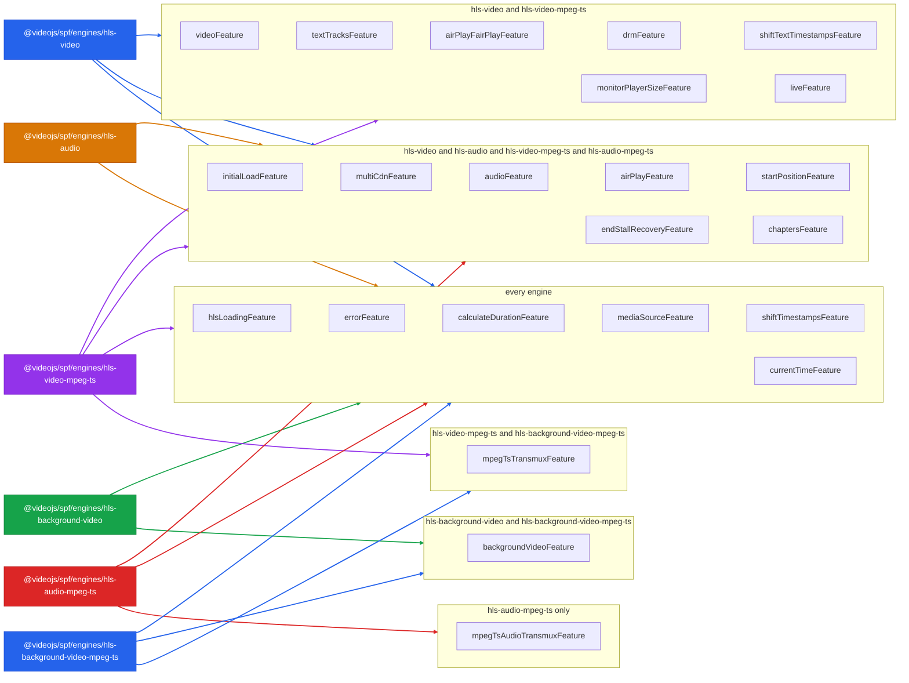

<!-- Generated by `pnpm -F @videojs/spf docs:reference`. Do not edit by hand; edit the JSDoc in the source. -->

# `@videojs/spf` API reference

`@videojs/spf` builds a playback engine by composing behaviors, grouped into features. This reference covers 6 engines, the 23 features they compose, the 39 behaviors the behavior entry points export, and the 22 composition exports that put them together. Each engine page lists its features and behaviors in composition order with the config, state, and context keys they resolve to; each feature page does the same for its behaviors; each behavior page shows what its setup reads and writes.

## Engines and features

Each engine's box and arrows share a color. Features are grouped by which engines compose them; each engine page lists its own features in composition order.

## Engines

| Entry point | Page | Description |
| --- | --- | --- |
| `@videojs/spf/engines/hls-video` | [hls-video](engines/hls-video.md) | Create an HLS playback engine: manifest resolution, adaptive track selection, segment loading over MediaSource, and end-of-stream coordination, composed from SPF behaviors. |
| `@videojs/spf/engines/hls-audio` | [hls-audio](engines/hls-audio.md) | Create an audio-only HLS playback engine: the video engine without its video and subtitle behaviors, chapters kept. |
| `@videojs/spf/engines/hls-background-video` | [hls-background-video](engines/hls-background-video.md) | Create a background-video playback engine: one video rendition pinned for the session, no audio or text, loading as soon as a source is set. |
| `@videojs/spf/engines/hls-video-mpeg-ts` | [hls-video-mpeg-ts](engines/hls-video-mpeg-ts.md) | Create an HLS playback engine that also plays MPEG-TS: `@videojs/spf/engines/hls-video`'s engine with each MPEG-TS segment transmuxed to fMP4 on the client before it reaches the SourceBuffer. fMP4 and CMAF play through it unchanged. |
| `@videojs/spf/engines/hls-audio-mpeg-ts` | [hls-audio-mpeg-ts](engines/hls-audio-mpeg-ts.md) | Create an audio-only HLS playback engine that also plays MPEG-TS: `@videojs/spf/engines/hls-audio`'s engine with each MPEG-TS audio rendition — an audio-only asset, the alternates of a video asset, or a video asset's default audio carried in its video segments — transmuxed to fMP4 on the client. |
| `@videojs/spf/engines/hls-background-video-mpeg-ts` | [hls-background-video-mpeg-ts](engines/hls-background-video-mpeg-ts.md) | Create a background-video engine that also plays MPEG-TS: `@videojs/spf/engines/hls-background-video`'s engine with each MPEG-TS segment transmuxed to fMP4 on the client. |

## Features

| Feature | Page | Description |
| --- | --- | --- |
| `airPlayFeature` | [airplay](features/airplay.md) | Plays to AirPlay receivers (WebKit only; inert elsewhere), unless the user sets `disableRemotePlayback`. |
| `airPlayFairPlayFeature` | [airplay-fairplay](features/airplay-fairplay.md) | Plays FairPlay-protected content on an AirPlay receiver, negotiating the receiver's keys while a session holds. |
| `audioFeature` | [audio](features/audio.md) | Plays audio: resolves the selected rendition's playlist, switches renditions, and buffers and loads its segments. |
| `backgroundVideoFeature` | [background-video](features/background-video.md) | Plays one video rendition for the whole session: the largest that fits the screen, picked once rather than adapted to bandwidth. |
| `calculateDurationFeature` | [calculate-duration](features/calculate-duration.md) | Calculates the presentation's duration from its selected tracks once they've loaded. |
| `chaptersFeature` | [chapters](features/chapters.md) | Adds the source's Apple JSON chapters (`EXT-X-SESSION-DATA`, `com.apple.hls.chapters`) to the media element as a hidden `chapters` text track per language. |
| `currentTimeFeature` | [current-time](features/current-time.md) | Mirrors the media element's `currentTime` into state, which segment loading reads to plan what to load next. |
| `drmFeature` | [drm](features/drm.md) | Plays DRM-protected content through Encrypted Media Extensions: negotiates a key system over the configured license servers, attaches its MediaKeys, and exchanges licenses. |
| `endStallRecoveryFeature` | [end-stall-recovery](features/end-stall-recovery.md) | Fires the media element's `ended` when Chrome freezes the playhead a few frames short of the end of a stream whose audio and video end at slightly different times. |
| `errorFeature` | [error](features/error.md) | Collects the errors the other features report into `state.errors`, per source. |
| `hlsLoadingFeature` | [hls-loading](features/hls-loading.md) | Fetches and parses the source's HLS multivariant playlist into the presentation the other features read. |
| `initialLoadFeature` | [initial-load](features/initial-load.md) | Defers loading until the media element's `preload` allows it or the user plays or seeks, mirroring native `HTMLMediaElement` preload behavior. |
| `liveFeature` | [live](features/live.md) | Plays live streams: reloads their playlists, keeps the seekable window current, starts at the live edge, and keeps the playhead inside the window. |
| `mediaSourceFeature` | [media-source](features/media-source.md) | Plays through Media Source Extensions: attaches a MediaSource to the media element, keeps its duration current, and ends the stream once every composed track type has loaded its last segment. |
| `monitorPlayerSizeFeature` | [monitor-player-size](features/monitor-player-size.md) | Monitors the player's rendered size, which enables capping video quality to it: the video selection rules' player resolution cap reads the size and does nothing without it. |
| `mpegTsAudioTransmuxFeature` | [mpeg-ts-audio-transmux](features/mpeg-ts-audio-transmux.md) | The audio-only counterpart of `mpegTsTransmuxFeature`: plays MPEG-TS audio renditions (an audio-only `.ts` asset, the audio-only TS alternates of a video asset, or a video asset's audio carried in its video segments, declared or not) by transmuxing their AAC to fMP4, with no video codec compiled in. |
| `mpegTsTransmuxFeature` | [mpeg-ts-transmux](features/mpeg-ts-transmux.md) | Plays HLS content packaged as MPEG-TS (H.264 + AAC) by transmuxing each segment to fMP4 on the client before it reaches the SourceBuffer. fMP4 and CMAF content plays through it unchanged. |
| `multiCdnFeature` | [multi-cdn](features/multi-cdn.md) | Plays sources served from several CDNs (redundant streams): keeps every track type on one CDN, and fails over to the next when a CDN fails, returning to it once its cooldown lapses. |
| `shiftTextTimestampsFeature` | [shift-text-timestamps](features/shift-text-timestamps.md) | Shifts text cues onto the playlist's zero-based timeline along with the audio and video, rebasing each cue by the shift `shiftTimestampsFeature` establishes. |
| `shiftTimestampsFeature` | [shift-timestamps](features/shift-timestamps.md) | Plays HLS content whose segment timestamps don't start at zero, by shifting them onto the playlist's zero-based timeline. |
| `startPositionFeature` | [start-position](features/start-position.md) | Starts playback at `state.startPosition` instead of zero. |
| `textTracksFeature` | [text-tracks](features/text-tracks.md) | Adds the source's subtitle and caption renditions to the media element as text tracks and loads the WebVTT cues of the showing one. |
| `videoFeature` | [video](features/video.md) | Plays video with adaptive bitrate: resolves the selected rendition's playlist, switches renditions as bandwidth changes, and buffers and loads its segments. |

## Behaviors

One row per entry point, in the order the first engine composes them; a module that exports several behaviors lists them all. "DOM" marks the behaviors that need a browser: they drive a media element, a `MediaSource`, or `MediaKeys`, and ship under `behaviors/dom/`.

| Behaviors | Entry point | DOM | Description |
| --- | --- | --- | --- |
| [syncPreload](behaviors/sync-preload.md#syncpreload) | [`@videojs/spf/behaviors/sync-preload`](behaviors/sync-preload.md) | — | Bidirectional sync between `state.preload` and `mediaElement.preload`. |
| [trackLoadTriggers](behaviors/dom/track-load-triggers.md#trackloadtriggers) | [`@videojs/spf/behaviors/dom/track-load-triggers`](behaviors/dom/track-load-triggers.md) | yes | Flips `loadActivated` to true the first time the user plays or seeks the current source, which lifts the preload gate on loading. |
| [resolvePresentation](behaviors/resolve-presentation.md#resolvepresentation) | [`@videojs/spf/behaviors/resolve-presentation`](behaviors/resolve-presentation.md) | — | Resolve an unresolved presentation by fetching and parsing its manifest. |
| [deriveCdnPriority](behaviors/derive-cdn-priority.md#derivecdnpriority) | [`@videojs/spf/behaviors/derive-cdn-priority`](behaviors/derive-cdn-priority.md) | — | Publishes which CDNs a source is served from, most-preferred first. |
| [setupFailoverMonitor](behaviors/setup-failover-monitor.md#setupfailovermonitor) | [`@videojs/spf/behaviors/setup-failover-monitor`](behaviors/setup-failover-monitor.md) | — | Returns a failed CDN to the candidates once its cooldown lapses. |
| [collectErrors](behaviors/collect-errors.md#collecterrors) | [`@videojs/spf/behaviors/collect-errors`](behaviors/collect-errors.md) | — | Collects the errors every behavior reports into `state.errors`, and clears them per source. |
| [calculatePresentationDuration](behaviors/calculate-presentation-duration.md#calculatepresentationduration) | [`@videojs/spf/behaviors/calculate-presentation-duration`](behaviors/calculate-presentation-duration.md) | — | Writes `presentation.duration` once the selected tracks make it derivable, using the resolver the engine supplies. |
| [setupMediaSource](behaviors/dom/setup-mediasource.md#setupmediasource) | [`@videojs/spf/behaviors/dom/setup-mediasource`](behaviors/dom/setup-mediasource.md) | yes | Creates a MediaSource for the current source, attaches it to the media element, and publishes it as `context.mediaSource` once open. |
| [updateMediaSourceDuration](behaviors/dom/update-mediasource-duration.md#updatemediasourceduration) | [`@videojs/spf/behaviors/dom/update-mediasource-duration`](behaviors/dom/update-mediasource-duration.md) | yes | Propagate `presentation.duration` to `mediaSource.duration` — exactly once per MediaSource. |
| [endOfStream](behaviors/dom/end-of-stream.md#endofstream) | [`@videojs/spf/behaviors/dom/end-of-stream`](behaviors/dom/end-of-stream.md) | yes | Calls `MediaSource.endOfStream()` once every loading track is complete and its last segments are appended and reached. |
| [resolveVideoTrack](behaviors/resolve-track.md#resolvevideotrack), [resolveAudioTrack](behaviors/resolve-track.md#resolveaudiotrack), [resolveTextTrack](behaviors/resolve-track.md#resolvetexttrack) | [`@videojs/spf/behaviors/resolve-track`](behaviors/resolve-track.md) | — | Fetches and parses the media playlist of the selected video, audio, or text track, so its segments become known. |
| [switchVideoTrack](behaviors/track-switching.md#switchvideotrack), [switchAudioTrack](behaviors/track-switching.md#switchaudiotrack), [switchTextTrack](behaviors/track-switching.md#switchtexttrack) | [`@videojs/spf/behaviors/track-switching`](behaviors/track-switching.md) | — | Picks the video, audio, or text track to play, and re-picks as bandwidth, user intent, or CDN state change, through a configurable chain of constraints and rules. |
| [setupVideoBufferActors](behaviors/dom/setup-buffer-actors.md#setupvideobufferactors), [setupAudioBufferActors](behaviors/dom/setup-buffer-actors.md#setupaudiobufferactors) | [`@videojs/spf/behaviors/dom/setup-buffer-actors`](behaviors/dom/setup-buffer-actors.md) | yes | Creates the `SourceBuffer` and segment loader for the selected video or audio track once the MediaSource is attached, and tears them down per source. |
| [loadVideoSegments](behaviors/dom/load-segments.md#loadvideosegments), [loadAudioSegments](behaviors/dom/load-segments.md#loadaudiosegments), [loadTextTrackSegments](behaviors/dom/load-segments.md#loadtexttracksegments) | [`@videojs/spf/behaviors/dom/load-segments`](behaviors/dom/load-segments.md) | yes | Tells the video, audio, or text segment loader what to load as the selected track or the playhead changes, under the preload policy. |
| [syncTextTracks](behaviors/dom/sync-text-tracks.md#synctexttracks) | [`@videojs/spf/behaviors/dom/sync-text-tracks`](behaviors/dom/sync-text-tracks.md) | yes | Mirrors the presentation's text tracks onto the media element as `<track>` elements and keeps their modes in step with the selection. |
| [setupTextTrackActors](behaviors/dom/setup-text-track-actors.md#setuptexttrackactors) | [`@videojs/spf/behaviors/dom/setup-text-track-actors`](behaviors/dom/setup-text-track-actors.md) | yes | Creates the text-track actor and its segment loader while a media element is attached, and tears them down with it. |
| [setupAirPlayFairPlay](behaviors/dom/setup-airplay-fairplay.md#setupairplayfairplay) | [`@videojs/spf/behaviors/dom/setup-airplay-fairplay`](behaviors/dom/setup-airplay-fairplay.md) | yes | Serve an AirPlay receiver's FairPlay key requests. |
| [exchangeLicenses](behaviors/dom/exchange-licenses.md#exchangelicenses) | [`@videojs/spf/behaviors/dom/exchange-licenses`](behaviors/dom/exchange-licenses.md) | yes | Open MediaKeySessions for the negotiated key system and exchange their licenses. |
| [setupMediaKeys](behaviors/dom/setup-media-keys.md#setupmediakeys) | [`@videojs/spf/behaviors/dom/setup-media-keys`](behaviors/dom/setup-media-keys.md) | yes | Negotiate a key system and attach its MediaKeys for the current source. |
| [establishStartMediaTime](behaviors/establish-start-media-time.md#establishstartmediatime) | [`@videojs/spf/behaviors/establish-start-media-time`](behaviors/establish-start-media-time.md) | — | Establish the presentation's coordinate origin — the `startTime` / `startMediaTime` / `startDate` triple — once per source, so every track lands on one 0-based presentation timeline. |
| [setupAirPlay](behaviors/dom/airplay.md#setupairplay) | [`@videojs/spf/behaviors/dom/airplay`](behaviors/dom/airplay.md) | yes | Lets WebKit hand an MSE stream to an AirPlay receiver, by giving the element a native-HLS fallback source and suspending loading while a session holds. |
| [trackCurrentTime](behaviors/dom/track-current-time.md#trackcurrenttime) | [`@videojs/spf/behaviors/dom/track-current-time`](behaviors/dom/track-current-time.md) | yes | Mirror `mediaElement.currentTime` into reactive state. |
| [applyStartPosition](behaviors/dom/apply-start-position.md#applystartposition) | [`@videojs/spf/behaviors/dom/apply-start-position`](behaviors/dom/apply-start-position.md) | yes | Start playback of a source at a requested position. |
| [trackPlayerResolution](behaviors/dom/track-player-resolution.md#trackplayerresolution) | [`@videojs/spf/behaviors/dom/track-player-resolution`](behaviors/dom/track-player-resolution.md) | yes | Mirror the player element's rendered pixel dimensions into reactive state, so a rendition cap can narrow candidates to what the element can actually show without reading the DOM at pick time — which would make the picker impure, and would never re-pick when the element resized. |
| [syncLiveSeekableRange](behaviors/dom/sync-live-seekable-range.md#syncliveseekablerange) | [`@videojs/spf/behaviors/dom/sync-live-seekable-range`](behaviors/dom/sync-live-seekable-range.md) | yes | Mirror the live window into the MediaSource's seekable range. |
| [seekToLiveEdge](behaviors/dom/seek-to-live-edge.md#seektoliveedge) | [`@videojs/spf/behaviors/dom/seek-to-live-edge`](behaviors/dom/seek-to-live-edge.md) | yes | Keep the playhead in the live window, via a two-state reactor gated on the preconditions for "we know where live is": |
| [recoverEndStall](behaviors/dom/recover-end-stall.md#recoverendstall) | [`@videojs/spf/behaviors/dom/recover-end-stall`](behaviors/dom/recover-end-stall.md) | yes | Recover the end-of-stream stall that Chrome exhibits on skewed A/V. |
| [loadChapters](behaviors/dom/load-chapters.md#loadchapters) | [`@videojs/spf/behaviors/dom/load-chapters`](behaviors/dom/load-chapters.md) | yes | Project Apple JSON chapters onto the host media element. |
| [selectAudioTrack](behaviors/select-tracks.md#selectaudiotrack), [selectVideoTrack](behaviors/select-tracks.md#selectvideotrack) | [`@videojs/spf/behaviors/select-tracks`](behaviors/select-tracks.md) | — | Picks the video or audio track once when a source's presentation resolves, and clears it on unload; the simple alternative to the `switch*` variants. When a presentation is resolved, sets `selectedVideoTrackId` / `selectedAudioTrackId` from a per-type default rule chain if no selection already exists. |
| [trackPlaybackRate](behaviors/dom/track-playback-rate.md#trackplaybackrate) | [`@videojs/spf/behaviors/dom/track-playback-rate`](behaviors/dom/track-playback-rate.md) | yes | Mirror `mediaElement.playbackRate` into reactive state. |
| [trackScreenResolution](behaviors/dom/track-screen-resolution.md#trackscreenresolution) | [`@videojs/spf/behaviors/dom/track-screen-resolution`](behaviors/dom/track-screen-resolution.md) | yes | Mirror the screen's pixel dimensions into reactive state, so a rendition cap can narrow candidates to what the screen can actually show without reading the environment at pick time — which would make the picker impure, and would never re-pick when the screen changed. |

## Composition

The four modules that turn behaviors into an engine, in the order they build on each other. Functions first, then the types each exports.

### [define-behavior](core/define-behavior.md)

The behavior contract: what a behavior declares, what its `setup` receives and returns, and the types that derive a composition's state, context, and config from a list of behaviors.

| Export | Kind | Description |
| --- | --- | --- |
| [`defineBehavior`](core/define-behavior.md#definebehavior) | function | Define a behavior, checking that the state and context keys it declares are exactly the ones its `setup` reads. |
| [`Behavior`](core/define-behavior.md#behavior) | interface | A behavior announces the state and context keys it needs alongside a `setup` function that receives deps (state, context, config) and returns an optional cleanup handle. |
| [`BehaviorCleanup`](core/define-behavior.md#behaviorcleanup) | type | What a behavior's `setup` may hand back to run on destroy: nothing, a function, or an object with `destroy()`, either of which may be async. |
| [`BehaviorDeps`](core/define-behavior.md#behaviordeps) | interface | What a behavior's `setup` receives: the state and context signals it declared, and the config. |
| [`ContextSignals`](core/define-behavior.md#contextsignals) | type | One writable signal per field of a context type: the platform objects and actor references a composition holds. |
| [`InferBehaviorConfig`](core/define-behavior.md#inferbehaviorconfig) | type | Infer the config shape a behavior requires from its deps parameter, whether it declares `config` or `config?`. |
| [`InferBehaviorContext`](core/define-behavior.md#inferbehaviorcontext) | type | Infer the context shape a behavior requires from its deps parameter. |
| [`InferBehaviorState`](core/define-behavior.md#inferbehaviorstate) | type | Infer the state shape a behavior requires from its deps parameter. |
| [`ResolveBehaviorConfig`](core/define-behavior.md#resolvebehaviorconfig) | type | Resolve the combined config shape from an array of behaviors (intersection of all requirements). |
| [`ResolveBehaviorContext`](core/define-behavior.md#resolvebehaviorcontext) | type | Resolve the combined context shape from an array of behaviors (intersection of all requirements). |
| [`ResolveBehaviorState`](core/define-behavior.md#resolvebehaviorstate) | type | Resolve the combined state shape from an array of behaviors (intersection of all requirements). |
| [`StateSignals`](core/define-behavior.md#statesignals) | type | One writable signal per field of a state type, which is how a composition exposes its state. |

### [define-external-signals](core/define-external-signals.md)

Declaring the state and context keys the host writes, so they reach a composition's types without a behavior that sets them.

| Export | Kind | Description |
| --- | --- | --- |
| [`defineExternalSignals`](core/define-external-signals.md#defineexternalsignals) | function | Behavior factory that defines a composition's external signals: state and context keys set and updated from outside the composition (typically by an adapter) that no composed behavior declares, because the behaviors that consult them only read them, and read them optionally. |

### [define-feature](core/define-feature.md)

Grouping behaviors into features, with the defaults and initial state they need, and flattening features into what a composition takes.

| Export | Kind | Description |
| --- | --- | --- |
| [`defineFeature`](core/define-feature.md#definefeature) | function | Define a feature: behaviors with the config defaults and initial state they need, kept as a tuple so a composition can derive its types from them. |
| [`flattenFeatures`](core/define-feature.md#flattenfeatures) | function | Flatten features into one behavior list, one `defaultConfig`, and one `initialState`, ready for `createComposition` or `defineCompositionFactory`. |
| [`Feature`](core/define-feature.md#feature) | interface | One capability of a composition: the behaviors that implement it, with the config defaults and initial state they need. |
| [`FlattenedFeatures`](core/define-feature.md#flattenedfeatures) | interface | What `flattenFeatures` returns: the inputs `createComposition` and `defineCompositionFactory` take. |

### [create-composition](core/create-composition.md)

Composing behaviors into a running engine: the composition, its options, and the factory that fixes a behavior list into an engine module's `createEngine`.

| Export | Kind | Description |
| --- | --- | --- |
| [`createComposition`](core/create-composition.md#createcomposition) | function | Create a composition from a set of behaviors. |
| [`defineCompositionFactory`](core/create-composition.md#definecompositionfactory) | function | A create function for one fixed list of behaviors with its defaults: what an engine module exports as its `createEngine`. |
| [`Composition`](core/create-composition.md#composition) | interface | A composition of behaviors with shared state and context signal maps. |
| [`CompositionOptions`](core/create-composition.md#compositionoptions) | interface | What `createComposition` takes beside the behaviors: the config, the defaults it falls back to, and the state and context values to seed. |
| [`ConfigWithDefaults`](core/create-composition.md#configwithdefaults) | type | `Cfg` with every key `Defaults` covers made optional: a default fills it when the caller leaves it out or passes `undefined`. |

How this reference is generated

Generated from the TypeScript sources and their JSDoc by `scripts/build-reference.ts`. It covers the composition factories the root entry exports from `src/core/composition/`, the playback engines (`@videojs/spf/engines/*`), their features (`@videojs/spf/features/*`), and the behaviors (`@videojs/spf/behaviors/*`). It does not cover the root entry's other exports, nor these entry points: `@videojs/spf/dom`, `@videojs/spf/hls`, `@videojs/spf/media-tracks`, `@videojs/spf/adapters/hls-audio`, `@videojs/spf/adapters/hls-background-video`, `@videojs/spf/adapters/hls-video`, `@videojs/spf/adapters/hls-video-mpeg-ts`, `@videojs/spf/adapters/hls-audio-mpeg-ts`, `@videojs/spf/adapters/hls-background-video-mpeg-ts`.

Regenerate with `pnpm -F @videojs/spf docs:reference`; `pnpm -F @videojs/spf docs:reference:check` fails when the committed output is stale.

A feature page lists the state keys it declares for the host to write under "External signals", apart from its behaviors; an engine page collects its features' under the same heading.

A behavior page opens with its module description when the source file starts with a JSDoc block set off from the imports by a blank line; the README uses that description for the page, else the first behavior's. Each page lists its remaining exports as Other functions and constants, and Types.

A behavior without JSDoc shows the JSDoc of the function its `setup` names; a type export without JSDoc shows what its declaration says it is; a symbol with no doc anywhere reads "No description."

A config key's doc is the config field JSDoc of the first behavior listed under "Read by" that has one. A state or context key's doc is the field JSDoc of the first behavior that writes the key, else the first that reads it; where that behavior is not on the page, the cell says which one it is documented on.

